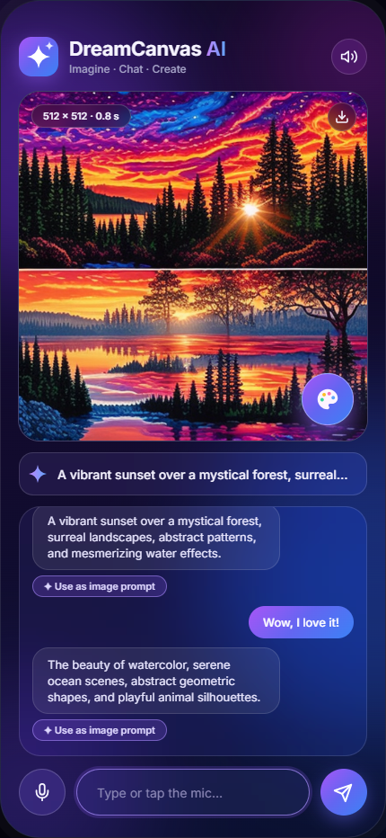
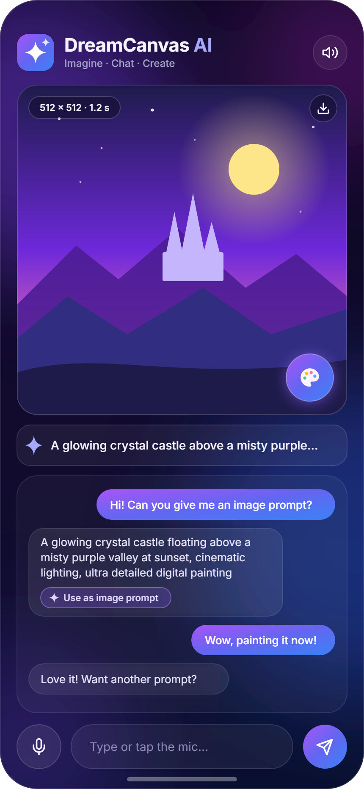
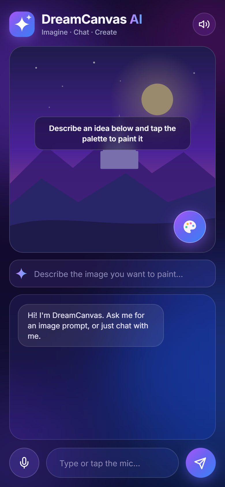
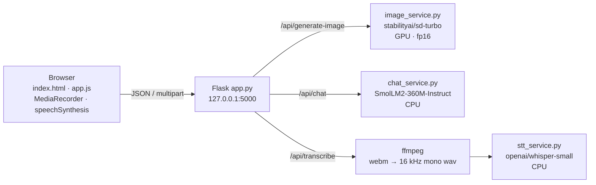

# DreamCanvas AI – A Simple Chatbot: Image Generation and LLM Responses

EE471 Mini Project 3. A small web app, designed in Figma first and then coded, that
combines three local AI models:

1. **Paint** – type a prompt, press the 🎨 paint button, and Stable Diffusion Turbo draws a 512 × 512 image.
2. **Talk** – press the mic, speak, and Whisper writes your words into the message box. Press **Send**:
   SmolLM2 answers, both messages appear in the chat history, and the reply is read aloud.
3. **Combine** – ask the bot for an image prompt, press **"Use as image prompt"** (or copy & paste it), and paint it.



| Design (Figma mockup) | App (desktop frame) | App (mobile) |
|---|---|---|
|  |  |  |

**Figma:** https://www.figma.com/design/qz3Aj4JiV5t3XboGna6Bkv/mockup?node-id=0-1

## Features

- Layout (top → bottom): title + icon → image output box with round paint button → prompt input → chat history → mic / message box / send.
- Dark theme, purple-blue gradient, glassmorphism, rounded corners. All values are in [`design/DESIGN_SPEC.md`](design/DESIGN_SPEC.md).
- Image box: shimmer loading animation, timing chip, download button.
- Chat: different user/bot bubbles, auto-scroll, animated "typing…" indicator, "Use as image prompt" under every bot reply.
- Mic: first click starts recording (red pulsing button), second click stops and transcribes. Nothing is sent automatically – press **Send** or **Enter**.
- Voice replies with the browser's `speechSynthesis` (English); 🔊 toggle in the header.
- Errors are shown as toasts; the API always answers errors as `{"error": "..."}`.

## Architecture



```
Browser ──► Flask (app.py) ──┬─► image_service.py ─► Stable Diffusion Turbo (GPU, fp16)
                             ├─► chat_service.py  ─► SmolLM2-360M-Instruct (CPU)
                             └─► stt_service.py   ─► ffmpeg ─► Whisper small (CPU)
```

| File | Purpose |
|------|---------|
| `app.py` | Flask routes, JSON error handlers, loads + warms up all models at start-up |
| `config.py` | Model names, image size/steps, chat limits, host/port |
| `image_service.py` | sd-turbo pipeline (fp16, attention + VAE slicing, CPU-offload fallback), saves PNGs to `outputs/` |
| `chat_service.py` | SmolLM2 chat template, last 6 messages as context, image-prompt mode (≤ 40 words, no quotes), sentence-safe trimming |
| `stt_service.py` | ffmpeg conversion, empty/silence detection (HTTP 422), Whisper transcription in English |
| `templates/index.html`, `static/style.css`, `static/app.js` | Frontend (design implemented 1:1) |
| `download_models.py` | Downloads only the needed model files |
| `test_api.py`, `test_ui.py` | API tests and browser end-to-end test (Playwright, fake microphone) |
| `design/` | `mockup.svg` (Figma import), `mockup.png` (2×), `DESIGN_SPEC.md` |

## Models

| Task | Model | Device | Settings |
|------|-------|--------|----------|
| Text → image | [`stabilityai/sd-turbo`](https://huggingface.co/stabilityai/sd-turbo) (fp16 variant) | GPU | 512 × 512, 2 steps, `guidance_scale=0` |
| Chatbot | [`HuggingFaceTB/SmolLM2-360M-Instruct`](https://huggingface.co/HuggingFaceTB/SmolLM2-360M-Instruct) | CPU | chat template, `max_new_tokens=120`, T = 0.6 |
| Speech → text | [`openai/whisper-small`](https://huggingface.co/openai/whisper-small) | CPU | `language="en"`, `task="transcribe"` |

None of the models is gated, so no Hugging Face login is needed.

## Setup

Requirements: Python 3.10+, an NVIDIA GPU with ≥ 4 GB VRAM (CPU also works, but slowly), and
[ffmpeg](https://ffmpeg.org/) on `PATH`.

```powershell
# from the repository root
python -m venv venv
venv\Scripts\python.exe -m pip install torch --index-url https://download.pytorch.org/whl/cu128
venv\Scripts\python.exe -m pip install -r MiniProject3\requirements.txt
```

> `diffusers==0.35.2` is pinned because newer versions require `huggingface_hub>=1.x`, which
> breaks `transformers 4.57`.

### Download the models (~4.3 GB, once)

```powershell
cd MiniProject3
..\venv\Scripts\python.exe download_models.py
```

Only the fp16 diffusers weights of sd-turbo are fetched (2.6 GB instead of 5 GB+).

### Run

```powershell
cd MiniProject3
..\venv\Scripts\python.exe app.py
```

Open <http://127.0.0.1:5000>. Start-up takes ~15 s (load + one warm-up run per model).
Allow microphone access when the browser asks.

### Tests

With the server running:

```powershell
..\venv\Scripts\python.exe test_api.py   # 9 API checks (creates test audio with Windows SAPI + ffmpeg)
..\venv\Scripts\python.exe test_ui.py    # 10 browser checks with Playwright + installed Chrome
```

## API

| Method | Route | Request | Response |
|--------|-------|---------|----------|
| GET | `/` | – | Web app |
| GET | `/api/health` | – | `{status, device, cpu_offload, timings}` |
| POST | `/api/generate-image` | JSON `{"prompt": "...", "seed"?: int}` | `{"image": "<base64 PNG>", "seconds": 0.7, "file": "....png"}` · empty prompt → **400** |
| POST | `/api/transcribe` | multipart field `audio` (browser webm/ogg/mp4, or wav) | `{"text": "...", "seconds": 1.8}` · empty/silent/too short → **422**, no file → **400** |
| POST | `/api/chat` | JSON `{"messages": [{"role": "user"\|"assistant", "content": "..."}]}` | `{"reply": "...", "seconds": 1.9}` · empty list → **400** |

Every error is returned as `{"error": "human readable message"}`.

## Measured performance

Laptop with an RTX 3050 Ti (4 GB VRAM), models warm:

| Step | Target | Measured |
|------|--------|----------|
| 512 × 512 image (sd-turbo, 2 steps) | < 5 s | **0.5 – 0.8 s** (server), ~0.8 – 1.4 s in the browser |
| Chatbot reply (SmolLM2, CPU) | < 4 s | **0.7 – 3.6 s** (typically 1.7 – 2.7 s) |
| Transcription (whisper-small, CPU, ~3 s clip) | < 3 s | **1.7 – 2.2 s** incl. ffmpeg |
| Peak VRAM | 4 GB | **3.1 GB** |
| Start-up | – | ~7 s loading + ~5 s warm-up |

## Hardware notes

- Stable Diffusion runs on the GPU in fp16 with attention slicing and VAE slicing. If the
  pipeline does not fit, `image_service.py` falls back to `enable_model_cpu_offload()`
  automatically (`/api/health` shows `cpu_offload: true`).
- SmolLM2 and Whisper run on the CPU so they never compete with Stable Diffusion for VRAM.
- Each model has a lock, so concurrent requests are processed one at a time per model.
- Generated images are also saved to `outputs/` (git-ignored).
