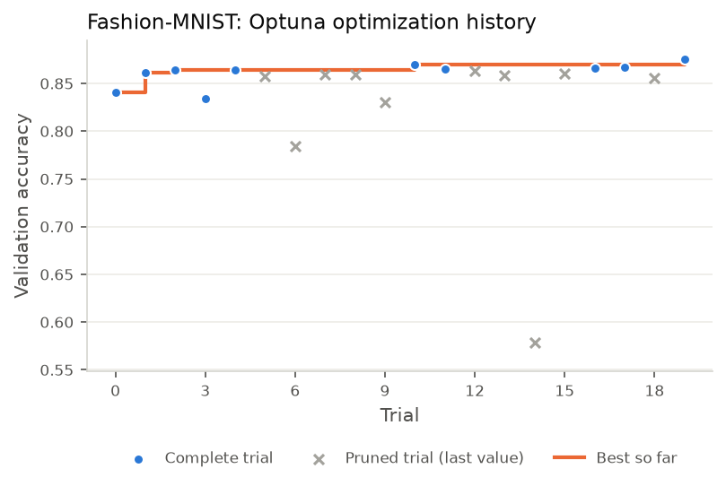
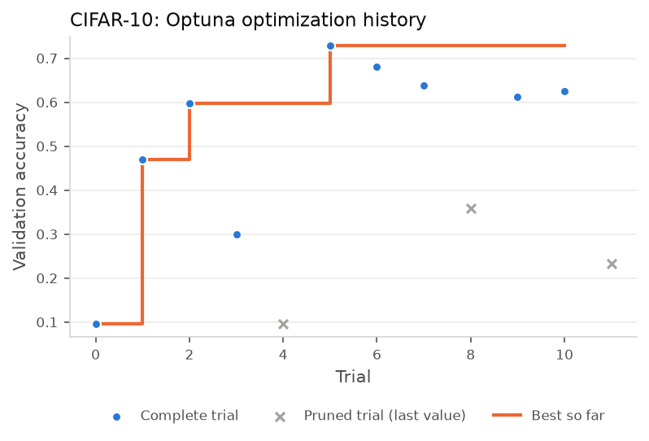

# Week 7 — Baseline vs. HPO-Optimized Models

Baselines follow the PyTorch tutorials exactly (Quickstart MLP for Fashion-MNIST; the "Training a Classifier" CNN for CIFAR-10). The optimized models come from an Optuna search (TPE sampler, seed 42, MedianPruner) on a 10% validation split, then a longer final training run that keeps the best validation epoch.

## Results (test set)

|  | Fashion baseline | Fashion optimized | CIFAR baseline | CIFAR optimized |
|---|---|---|---|---|
| Test accuracy | 64.15% | 89.58% | 54.26% | 81.07% |
| Test loss | 1.090 | 0.316 | 1.274 | 0.650 |
| Epochs | 5 | 15 (best 15) | 2 | 15 (best 10) |
| Training time | 1.7 min | 4.4 min | 2.6 min | 15.5 min |
| Parameters | 669,706 | 1,863,690 | 62,006 | 2,197,706 |
| HPO (trials, time) | – | 20 x 3 ep, 8.5 min | – | 12 x 3 ep, 22.6 min |

## Best hyperparameters

- **Fashion-MNIST** (val acc 87.53%, trial 19): optimizer=Adam, lr=1.61e-04, batch_size=32, hidden_size=1024, dropout=0.120, weight_decay=1.32e-06
- **CIFAR-10** (val acc 72.94%, trial 5): width=64, dropout=0.124, batchnorm=on, augment=off, optimizer=Adam, lr=1.49e-04, batch_size=128, weight_decay=5.53e-04

## Optimization history

| Fashion-MNIST | CIFAR-10 |
|---|---|
|  |  |

## Why hyperparameter optimization matters

Same data and framework; only the training settings and the model size (and, for CIFAR-10, a configurable CNN instead of the tiny tutorial net) were chosen by the search. The error rate fell by a factor of about 2.4-3.4 on the two datasets. The tutorial settings demonstrate the API rather than aim for accuracy, so a systematic search pays off quickly even with a small budget, and the right learning rate matters more than the optimizer name.

- **Fashion-MNIST:** test accuracy 64.15% → 89.58% (**+25.43 pp**, error rate 35.9% → 10.4%), test loss 1.090 → 0.316. Most important hyperparameter (fANOVA): **dropout** (34% of the explained variance).
- **CIFAR-10:** test accuracy 54.26% → 81.07% (**+26.81 pp**, error rate 45.7% → 18.9%), test loss 1.274 → 0.650. Most important hyperparameter (fANOVA): **lr** (38% of the explained variance).

## Limitations

- **Compute:** everything ran on one laptop GPU (RTX 3050 Ti, 4 GB); the Docker/Cog containers serve the models on CPU. This limited the budget to short trials.
- **Few, short trials:** 20 trials (Fashion) and 12 trials (CIFAR) of 3 epochs each, with median pruning; no trial was too slow, so the planned budget was kept. Short trials favour settings that learn fast: on CIFAR-10 the search turned augmentation off, and the final model overfit (train loss 0.11 vs. validation loss 0.60 at the best epoch) and stopped early at epoch 15, so longer trials would likely pick augmentation. The importance values come from only 10/9 complete trials and are rough.
- **Test set kept out of the search:** HPO and best-epoch selection used only a fixed 10% validation split of the training set, so the test accuracy is an honest estimate. The optimized models therefore trained on 90% of the training data, the baselines on 100%.
- **One seed, one split:** no repeated runs, so differences below ~0.5 pp should not be over-interpreted.
